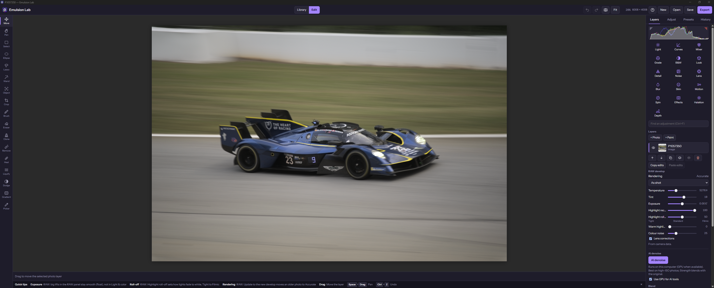

# Emulsion



A one-time-purchase photo editor ("Photoshop but better", about $10, no subscription). Everything runs locally; photos never leave the device.

| Edition | What it is | Status |
|---|---|---|
| **Emulsion Lite** | Free web edition: a static folder for any web host (or one self-contained HTML file). Lab's features are shown, greyed, with a link. | Working prototype (this repo); deploy: `docs/LITE_WEB.md` |
| **Emulsion Lab** | Desktop edition (Tauri v2, Windows first). Same editor, plus native files, projects, no size caps; RAW, GPU and local ML to come. | Phase 1 shell built. See `docs/LAB.md` |

"Prism" is the internal codename (repo and package names). "Emulsion" is the public name. Run a trademark and domain check before spending money on branding.

## Quick start

```
npm install
npm run dev            # live-reload dev server
npm run build          # writes dist-web/ (upload it) and dist/emulsion-lite.html (open it in a browser)
npm test               # engine tests, no browser needed
npm run test:smoke     # builds, then drives the app in jsdom
npm run test:e2e       # builds, then drives the app in real Chromium (desktop + phone viewport)
```

## Layout

```
src/engine/adjust.js    pure pixel engine: adjustments, curves, blur, LUTs (no DOM)
src/engine/smart.js     XMP preset import, magic wand, object select, outlines, content-aware fill (no DOM)
src/app/                the app as ES modules, entry main.js (module map in docs/ARCHITECTURE.md)
src/ui/style.css        styles
index.html              dev page (npm run dev) and build template
scripts/build.mjs       bundles with Vite: dist-web/ and dist/emulsion-lite.html, checked for Lab code (--lab: dist-lab/)
src-tauri/              Emulsion Lab: Tauri v2 shell (Rust), icons, installer config
tests/                  engine tests, jsdom smoke test, helpers
docs/                   architecture, roadmap, decisions, known issues, format notes
CLAUDE.md               start here when working with Claude Code
```

## Working with Claude Code

Open this repo, run `claude`, and let it read `CLAUDE.md`. The first session should follow Phase 0 in `docs/ROADMAP.md`.

## License

Not chosen yet (`UNLICENSED` in package.json). Third-party presets used for testing are not redistributable and are gitignored.
